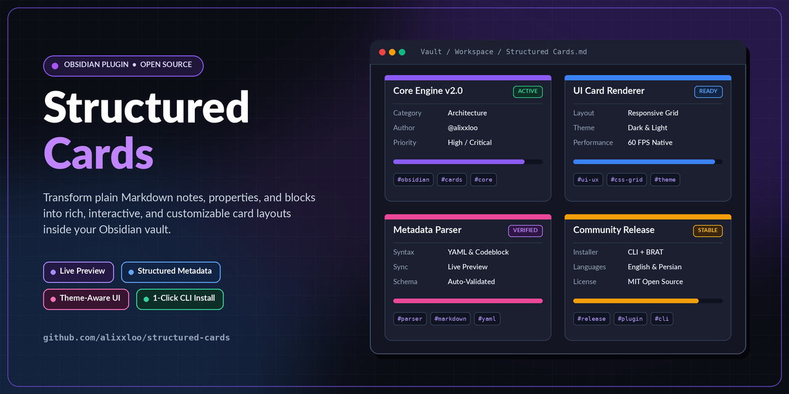
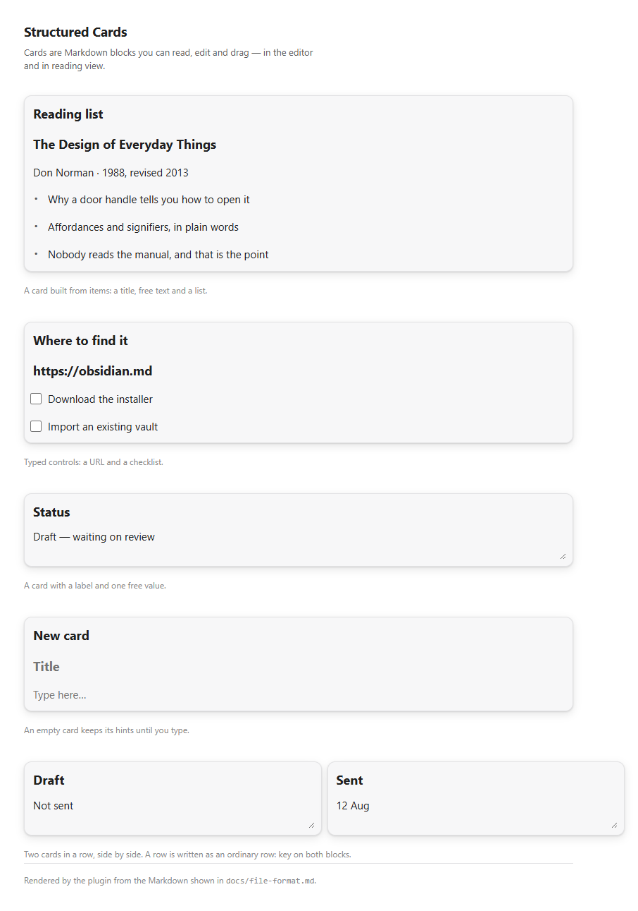
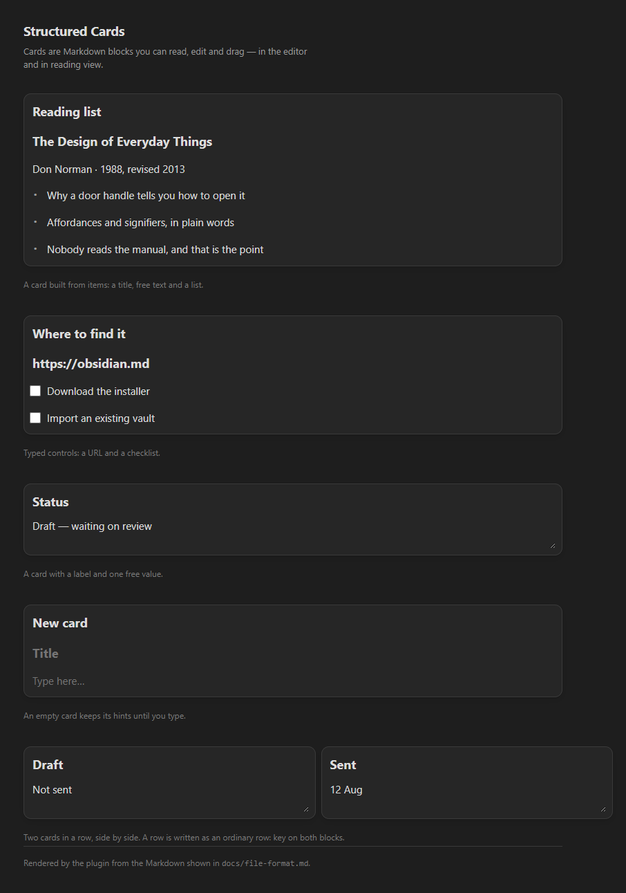
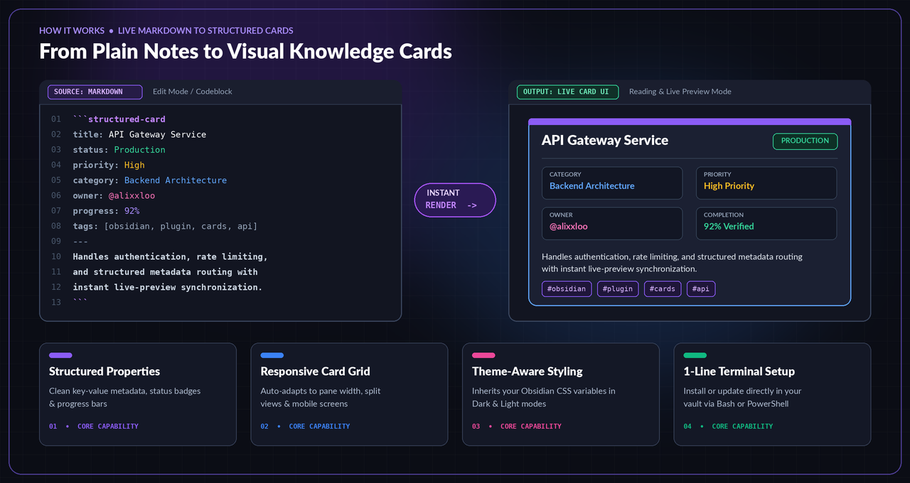
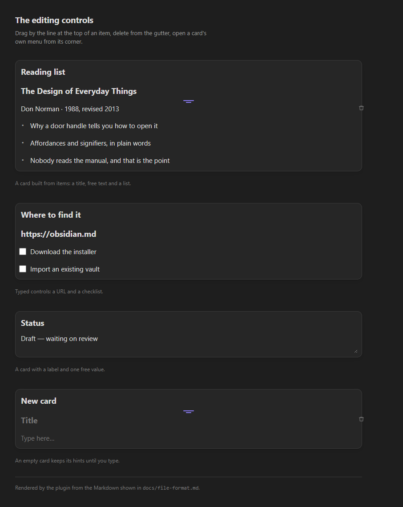
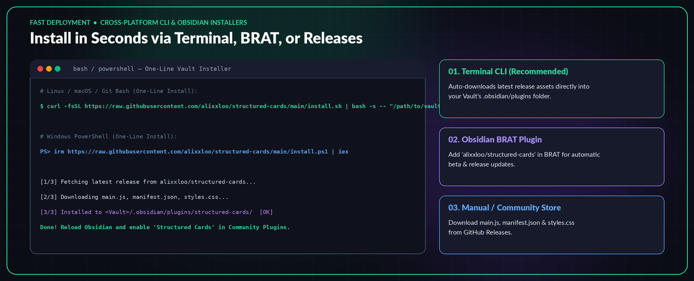

<div dir="rtl" align="right">



# Structured Cards

**فیلدهای تایپ‌دار و کشیدنی که درون مارک‌داون شما زندگی می‌کنند.**

[🌐 English](README.md) | [🇮🇷 فارسی (Persian)](README.fa.md)

[](https://github.com/alixxloo/structured-cards/releases/latest)
[](https://github.com/alixxloo/structured-cards/releases)
[](https://github.com/alixxloo/structured-cards/stargazers)
[](manifest.json)
[](LICENSE)
[](tests/)

[نصب](#نصب) · [سینتکس](#راهنمای-استفاده) · [مرجع](#کلیدهای-structured-field) · [مستندات](#مستندات)

</div>

---



Structured Cards بلوک‌های مارک‌داونِ داخل پرانتز (`fenced block`) را به فیلدهایی
برچسب‌دار و تایپ‌دار تبدیل می‌کند که می‌توانید در همان‌جا ویرایش‌شان کنید، بکشید و
جابه‌جا کنید. یک منوی کشویی وضعیت، یک جعبهٔ کلید API، یک کادر متن چندخطی — همه به
شکل کارت نمایش داده می‌شوند، هر جا خواستید می‌کشیدشان، و در زیرِ همه‌چیز هنوز
**متن سادهٔ خودِ یادداشت** است.

## چرا Structured Cards؟

بیشتر افزونه‌هایی که با دادهٔ ساخت‌یافته کار می‌کنند، داده را جای دیگری نگه
می‌دارند: یک فایل JSON، یک پایگاه‌داده، یک بستهٔ رمزنگاری‌شده. این کار شدنی است،
اما یعنی یادداشت‌هایتان دیگر منبعِ حقیقت نیستند و قابلیت جابه‌جایی‌شان را از دست
می‌دهند.

این افزونه برعکس این رویه است. **هر فیلد، همان یک بلوک کد است.**

- **یادداشت‌هایتان قابل‌حمل می‌مانند.** افزونه را حذف کنید و والتمان را از
  دستگاهی به دستگاه دیگر منتقل کنید — داده هنوز همان‌جا، خوانا، درون متن است.
- **دیفاکس معنادارند.** تغییر یک فیلد در `git diff` یک تغییر کوچک و خوانا
  می‌شود، نه بازنویسی یک بلابِ نامفهوم.
- **همگام‌سازی بی‌دردسر است.** Obsidian Sync و iCloud و Dropbox و Syncthing —
  هیچ‌کدام نمی‌دانند این افزونه وجود دارد و هیچ‌کدام هم نیازی به دانستن ندارند.
- **اگر خراب شود، بلند اعلام می‌کند.** اگر افزونه‌ای روزی لود نشد، بلوک خام را
  در خود یادداشت می‌بینید؛ داده بی‌صدا از دست نمی‌رود.

### ویژگی‌های کلیدی

- **هشت نوع مقدار** — `text`، `multiline`، `url`، `secret`، `number`،
  `select`، `tags`، `code`.
- **دو نوع بلوک** — [`structured-field`](#structured-field) برای یک مقدار
  تایپ‌دار یا فهرستی از آیتم‌ها، و [`structured-card`](#structured-card)
  چندبخشی با سکشن‌های عنوان‌دار و چیدمان ستونی.
- **آیتم‌ها درون کارت** — عنوان، سرتیتر، متن آزاد، بولت، چک‌باکس، موارد
  شماره‌دار و جداکننده.
- **Secretها** به‌صورت پیش‌فرض ماسک می‌شوند و فیلدبه‌فیلد آشکار می‌گردند.
- **ردیف‌ها** دو کارت یا بیشتر را کنار هم می‌گذارند؛ به‌صورت یک کلید سادهٔ
  `row:` روی هر بلوک نوشته می‌شود.
- **عرض و ارتفاع** هر کارت — درصدی با حداقلِ معقول، یا دقیقاً برحسب پیکسل.
- **RTL و LTR** به‌تفکیک هر کارت، به‌علاوه یک پیش‌فرض برای کل والتم. از روز
  اول برای یادداشت‌های دوجهته ساخته شده است.
- **تمپلیت‌ها** — هر آرایشی از کارت‌ها را به‌عنوان تمپلیت ذخیره کنید، هر جا
  بخواهید درجش کنید، و نامش را عوض کنید، به‌روزرسانی و تکثیر و حذفش کنید، یا
  برون‌سپاری و درون‌سپاریش کنید.
- **همه‌چیز کشیدنی است** — آیتم‌ها را درون کارت بکشید، کارت‌ها را در نمای
  ویرایش و خواندن جابه‌جا کنید، با لبه یا گوشه اندازه‌شان را عوض کنید، با
  راهنماهای تراز که به همسایه‌ها می‌چسبند.

<p align="center">
  
</p>



## قابلیت‌های ویرایش

<p align="center">
  
</p>

- **آیتم را** با خط کوچک بالایش بکشید.
- **کارت را** با دستگیره‌اش بکشید — هم در ویرایشگر هم در نمای خواندن؛
  راهنماهای تراز به کارت‌های مجاور می‌چسبند.
- **اندازهٔ کارت** را با لبه یا گوشه‌اش عوض کنید.
- **منوی هر کارت** برای ویرایش ویژگی‌ها، تکثیر و حذف.
- **کارت خالی راهنمای خودش را نگه می‌دارد.** کارت تازه تا وقتی تایپ نکنید
  `Title` و `Type here…` نشان می‌دهد؛ این راهنما هرگز از استخراج می‌شود و در
  یادداشت نوشته نمی‌شود.
- **مقادیر با blur ثبت می‌شوند**، نه با هر فشارِ کلید.

هر چیزی که حاشیه‌ای است — دستگیره‌های کشیدن، کنترل‌های ویرایش، راهنماهای تراز،
انیمیشن‌ها — در تنظیمات خاموش‌شدنی است و هرکدام بلافاصله اعمال می‌شود.

## راهنمای استفاده

دو بلوک کدِ محصور (fenced) که به‌شکلی متنِ عادیِ خودِ یادداشت نوشته و ذخیره
می‌شوند:

### `structured-field`

<div dir="ltr" align="left">

````markdown
```structured-field
id: status
label: Status
type: select
width: 45%
options: todo, doing, done
value: doing
```
````

</div>

یک secret که ماسک می‌ماند:

<div dir="ltr" align="left">

````markdown
```structured-field
id: api-key
label: API key
type: secret
width: 60%
placeholder: sk-...
```
````

</div>

ترکیب تایپ‌های مختلف و آیتم‌ها در یک کارت:

<div dir="ltr" align="left">

````markdown
```structured-field
id: deployment
label: Deployment notes
type: text
width: 100%
item: title|Release 0.2
item: separator
item: checkbox|Migrations reviewed|true
item: numbered|Publisher|Zapier
item: text|See the docs for the full changelog.
```
````

</div>

و هر ژست ترکیبی از جهت، تراز و اُفست آزاد است — این پلاگین برای متون دوجهته
(فارسی/عربی + لاتین) از پایه ساخته شده:

<div dir="ltr" align="left">

````markdown
```structured-field
id: title-note
label: عنوان یادداشت
type: text
row: planning
width: 45%
direction: rtl
align: center
```
````

</div>

### `structured-card`

کارت‌های چندبخشی با سکشن‌های عنوان‌دار، شمار ستون‌های اختیاری و ردیف‌های
تایپ‌دار:

<div dir="ltr" align="left">

````markdown
```structured-card
title: Meeting — weekly review
layout: 2
size: medium

## Attendees

- Present|text|Alex, Sam

## Decisions

! Decision log
- Status|select|accepted|options=accepted, rejected, deferred
- Notes|multiline|First summary line, kept in the note.|dir=ltr

## Follow-ups

. Check the budget on Friday.
```
````

</div>

قواعد کاملِ escape، نگه‌داری مقادیر و حالت‌های مرزی:
[`docs/file-format.md`](docs/file-format.md).

## نصب



**به Obsidian نسخهٔ 1.5.0 یا جدیدتر نیاز دارد — دسکتاپ و موبایل.**

### روش ۱ — نصب‌کنندهٔ یک‌خطی ترمینال (سریع‌ترین)

سه فایل `main.js`، `manifest.json` و `styles.css` را از آخرین ریلیز به
`<your-vault>/.obsidian/plugins/structured-cards/` می‌آورد، اگر فایل
`community-plugins.json` موجود باشد افزونه را در آن فعال می‌کند، و اگر فایلِ
ریلیزی در دسترس نبود به ساخت از سورس بر می‌گردد.

**لینوکس / مک / Git Bash در ویندوز:**

<div dir="ltr" align="left">

```bash
curl -fsSL https://raw.githubusercontent.com/alixxloo/structured-cards/main/install.sh | bash -s -- "/path/to/your/vault"
```

</div>

**ویندوز PowerShell (فرم متغیر محیطی، سازگار با `irm | iex`):**

<div dir="ltr" align="left">

```powershell
$env:VAULT = "C:\Path\To\Your\Vault"; irm https://raw.githubusercontent.com/alixxloo/structured-cards/main/install.ps1 | iex
```

</div>

**ویندوز PowerShell (با آرگومان، از طریق `scriptblock`):**

<div dir="ltr" align="left">

```powershell
& ([scriptblock]::Create((irm https://raw.githubusercontent.com/alixxloo/structured-cards/main/install.ps1))) -VaultPath "C:\Path\To\Your\Vault"
```

</div>

سپس Obsidian را دوباره باز کنید و در `Settings → Community plugins` گزینهٔ
**Structured Cards** را فعال کنید.

### روش ۲ — از طریق BRAT

افزونهٔ [BRAT](https://github.com/TfTHacker/obsidian42-brat) را نصب کنید، دستور
**Add a plugin** آن را اجرا کنید و وارد کنید:

<div dir="ltr" align="left">

```text
alixxloo/structured-cards
```

</div>

ریلیزهای بعدیِ تگ‌شده به‌طور خودکار توسط BRAT دنبال می‌شوند.

### روش ۳ — نصب دستی

سه فایل — `manifest.json`، `main.js` و `styles.css` — را از
[آخرین ریلیز](https://github.com/alixxloo/structured-cards/releases/latest)
دانلود کنید و در این مسیر بگذارید:

<div dir="ltr" align="left">

```text
<your-vault>/.obsidian/plugins/structured-cards/
```

</div>

Obsidian را دوباره باز کنید و سپس در `Settings → Community plugins` گزینهٔ
**Structured Cards** را فعال کنید.

### روش ۴ — ساخت از سورس

<div dir="ltr" align="left">

```bash
git clone https://github.com/alixxloo/structured-cards
cd structured-cards
npm install
npm run build
```

</div>

سپس سه فایل `main.js`، `manifest.json` و `styles.css` را همانند روش ۳ کپی کنید.
هر تگِ نسخهٔ جدید به‌طور خودکار با گردش‌کارِ ریلیزِ مخزن ساخته و منتشر می‌شود؛
بنابراین assetها همیشه دقیقاً بیلدِ همان تگ‌اند.

### به‌روزرسانی

Structured Cards کدِ به‌روزرسانیِ خودش را ندارد؛ این کار Obsidian انجام می‌دهد:

۱. `Settings → Community plugins`
۲. دکمهٔ **Check for updates**، یا منوی `...` خود افزونه
۳. `Update` کنار Structured Cards

Obsidian آخرین نسخه را از `manifest.json` همین مخزن می‌خواند و فایل‌های جدید را
از GitHub Release دانلود می‌کند؛ پس تنظیماتِ `data.json` دست‌نخورده می‌مانند. تا
وقتی افزونه به فهرست جامعهٔ افزونه‌ها نپیوسته است، به‌روزرسانی را با BRAT
انجام دهید.

## مرجع

### دستورها

| دستور | کاری که می‌کند |
| --- | --- |
| `Insert field` | یک فیلد در محل مکان‌نما اضافه می‌کند |
| `Insert template` | یک تمپلیت ذخیره‌شده را درج می‌کند |
| `Save selected/current layout as template` | کارت‌های فعلی را به‌عنوان تمپلیت ذخیره می‌کند |
| `Manage templates` | تغییر نام، به‌روزرسانی، تکثیر، حذف، درون‌سپاری و برون‌سپاری تمپلیت‌ها |

کلیک‌راست در ویرایشگر هم گزینهٔ **Add field** را نشان می‌دهد.

### تنظیمات

| تنظیم | پیش‌فرض | اثر |
| --- | --- | --- |
| `Mask secrets by default` | خاموش | هر کارت مخفی از ابتدا ماسک شود |
| `Default text direction` | `auto` | `auto` / `ltr` / `rtl` برای کارت‌های جدید |
| `Show editing controls` | روشن | منوهای کارت، دستگیره‌های اندازه |
| `Show drag handles` | روشن | دستگیره‌های کشیدن (نیازمند کنترل‌های ویرایش) |
| `Responsive layout` | روشن | جمع‌کردن ردیف‌های چندستونه در صفحه‌های باریک |
| `Snap guides` | روشن | راهنماهای تراز هنگام کشیدن |
| `Animations` | روشن | ترنزیشن‌ها و حرکت |
| `Templates` | — | مدیریت تمپلیت‌های کارت (نام، به‌روزرسانی، تکثیر، حذف، برون/درون‌سپاری) |

همچنین یک سوئیچ دیگر به نام `debugLogging` فقط در `data.json` وجود دارد؛ یک
شیار تشخیصی است، نه یک سطر تنظیماتِ رابط.

### کلیدهای `structured-field`

| کلید | نمونه | اثر |
| --- | --- | --- |
| `id:` | `id: status` | شناسهٔ پایدار (در سینک و رفت‌وبرگشت حفظ می‌شود)؛ اگر ننویسید ساخته می‌شود |
| `label:` | `label: Status` | عنوان فیلد؛ چندخطی با `label: \|` |
| `label-hidden: true` | | رندر بدون متن عنوان |
| `type:` | `type: select` | یکی از هشت نوع |
| `value:` | `value: doing` | مقدار ذخیره‌شده؛ چندخطی با `value: \|` |
| `width:` | `width: 45%` | درصد (با حداقلِ معقول) یا دقیق `px` |
| `height:` | `height: 120px` | ارتفاع به پیکسل (multiline و code) |
| `row:` | `row: planning` | فیلدها را در یک خط گروه می‌کند |
| `offset:` | `offset: 12px` | اُفست اضافه درون ردیف |
| `align:` | `align: center` | `start` / `center` / `end` درون ردیف |
| `direction:` | `direction: rtl` | `auto` / `ltr` / `rtl` مختص همین فیلد |
| `masked:` | `masked: false` | آشکارکردن یک فیلد مخفی |
| `required:` | `required: true` | علامت‌گذاری مقدار به‌عنوان الزامی |
| `placeholder:` | `placeholder: sk-…` | متن راهنما هنگام خالی بودن |
| `default:` | `default: doing` | مقداری که فیلدِ تازه با آن شروع می‌شود |
| `options:` | `options: todo, doing, done` | گزینه‌های جدا با کاما برای `select` |
| `prefix:` / `suffix:` | `prefix: $` | متن ثابت دور مقدار |
| `help:` | `help: lowercase name` | یک سطر راهنما زیر فیلد |
| `validation:` | | مشخصهٔ اعتبارسنجی (مرجع فیلد را ببینید) |
| `title-size:` تا `title-direction:` | `title-weight: bold` | استایل عنوان: اندازه، وزن، رنگ، کج‌نویسی، جهت |
| هر کلید دیگر | `owner: alixx` | متادیتای سفارشی — ذخیره می‌شود، روی کارت رندر می‌شود، سرِ برگشت عیناً بر می‌گردد |

### سطرهای آیتم `structured-field`

آیتم‌های `text`، `bullet`، `url`، `secret` و `multiline` یک سطر اختیاریِ جهت هم
می‌پذیرند (`item: text\|متن\|rtl`).

| سطر | نتیجه |
| --- | --- |
| `item: title\|Heading Text` | یک عنوان آیتم |
| `item: title-text\|Title\|Value` | عنوانِ برچسب‌دار با مقدار اختصاصی |
| `item: text\|Value` | یک سطر متن ساده |
| `item: bullet\|Value` | یک سطر بولت |
| `item: numbered\|Title\|Value` | یک مورد شماره‌دار (با شمارهٔ اختیاری) |
| `item: checkbox\|Title\|true` | یک چک‌باکس (تیک‌خورده / تیک‌نخورده) |
| `item: url\|Value` | یک آیتم URL |
| `item: secret\|Value` | یک آیتم مخفیِ ماسک‌شده |
| `item: multiline\|Value` | یک ناحیهٔ یادداشت چندخطی |
| `item: separator` | یک جداکنندهٔ افقی |

### مرجع `structured-card`

**کلیدهای سطح بالا**

| کلید | مقادیر |
| --- | --- |
| `title:` | عنوان کارت (پیش‌فرض `Structured card`) |
| `layout:` | `auto`، `1`، `2`، `3`، `4` — چیدمان ستونی سکشن‌ها |
| `size:` | `small`، `medium`، `large`، `custom` |
| `custom-width:` | عرض وقتی `size: custom` است |
| `gap:` | فاصلهٔ بین آیتم‌ها به پیکسل |
| `density:` | `compact`، `comfortable` |
| `full-width: true` | درازکشیدن تا تمام عرض ادیتور |
| `breakpoint:` | عرض پیکسلی که واکنش‌گرایی از آن فعال می‌شود |
| هر کلید دیگر | متادیتای کارت که روی کارت رندر می‌شود |

**سکشن‌ها و آیتم‌ها درون یک کارت**

- `## عنوان بخش` — شروع یک سکشن
- `section-gap: N` / `section-full-width: true` — فاصله/عرض مختص همان سکشن
- `! Heading` — یک سرتیتر درون سکشن
- `. متن` — یک سطر متن ساده
- `---` — یک جداکننده

- سطرهای فیلدِ تایپ‌دار: به شکل `- برچسب|نوع|مقدار|کلید=مقدار …`

  گزینه‌های مجاز بعد از سگمنت مقدار: `id=`، `default=`، `options=`، `span=`،
  `full=true`، `dir=`، `masked=false`، `required=true`، `placeholder=`،
  `min-width=`، `class=`، `prefix=`، `suffix=`، `help=`، `validation=`. هر
  زوج `کلید=مقدار` شناخته‌شدهٔ دیگری به‌عنوان متادیتا ذخیره و روی کارت رندر
  می‌شود.

## مستندات

| سند | چه چیزی در آن است |
| --- | --- |
| [`docs/field-reference.md`](docs/field-reference.md) | تک‌تک کلیدها، تایپ‌ها و تنظیمات |
| [`docs/file-format.md`](docs/file-format.md) | فرمت روی‌دیسکِ بلوک‌ها و قواعد escape آن |
| [`docs/architecture.md`](docs/architecture.md) | چگونگی سازماندهی کد و دلیلش |
| [`docs/development.md`](docs/development.md) | بیلد، بستر تست، افزودن یک نوع فیلد تازه |
| [`docs/release-process.md`](docs/release-process.md) | چگونگی برش و ارسال یک ریلیز |
| [`docs/known-limitations.md`](docs/known-limitations.md) | چه چیزهایی تأیید شده و چه چیزهایی گازتان را می‌گیرد |
| [`docs/release-notes-0.1.0.md`](docs/release-notes-0.1.0.md) | سفرِ ردگیری‌شدهٔ پشت این ریلیز |
| [`CHANGELOG.md`](CHANGELOG.md) | تاریخچهٔ انتشار |

## وضعیت

**منتشر شده** — مخزن عمومی است و تگ `0.1.0` دارد، همراه یک GitHub Release حامل
`manifest.json` و `main.js` و `styles.css`: دقیقاً همان فایل‌هایی که نصب‌کنندهٔ
Obsidian دانلود می‌کند. روند ریلیز از
[`docs/release-process.md`](docs/release-process.md) پیروی کرده است — عمومی
شدن قبل از تگ‌گذاری.

این **نخستین انتشار عمومی** است: پایدار و تست‌شده، اما جوان. هنوز وارد فهرست
افزونه‌های جامعهٔ Obsidian نشده؛ تا آن زمان از assetهای ریلیز، از BRAT، یا با
نصب‌کنندهٔ یک‌خطی بالا نصب کنید.

این پروژه دربارهٔ لبه‌هایش هم صادق است:
[`docs/known-limitations.md`](docs/known-limitations.md) دقیقاً فهرست می‌کند چه
چیزهایی تأیید شده و چه چیزهایی نه — از جمله چیزهایی که تستِ خودکار به آن نمی‌رسد،
مثل کشیدنِ واقعی با نشانگر و آبشارِ واقعی CSS تم‌ها.

## مشارکت

Issue و Pull Request خوش می‌آید. لطفاً پیش از هرچیز
[`CONTRIBUTING.md`](CONTRIBUTING.md) و [`CODE_OF_CONDUCT.md`](CODE_OF_CONDUCT.md)
را بخوانید. گزارش‌های امنیتی از طریق [`SECURITY.md`](SECURITY.md) می‌آید، نه
میز Issue.

## لایسنس

MIT — ببینید [`LICENSE`](LICENSE).

</div>
